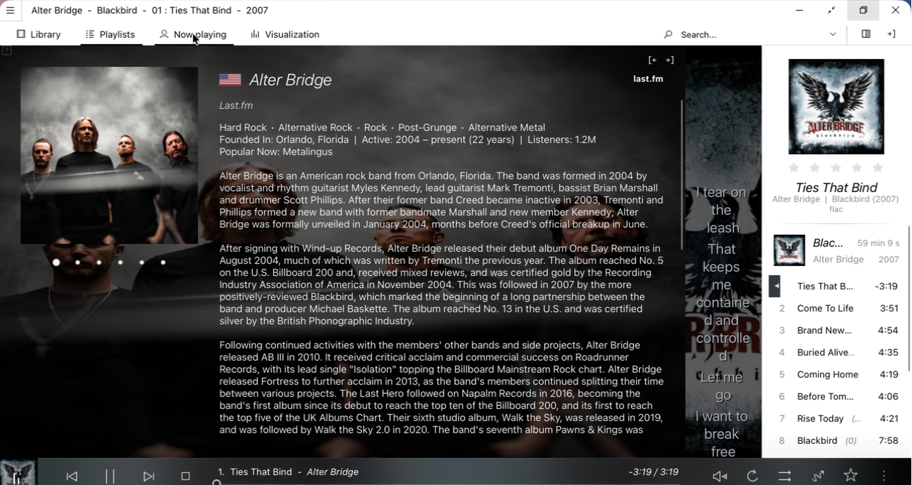
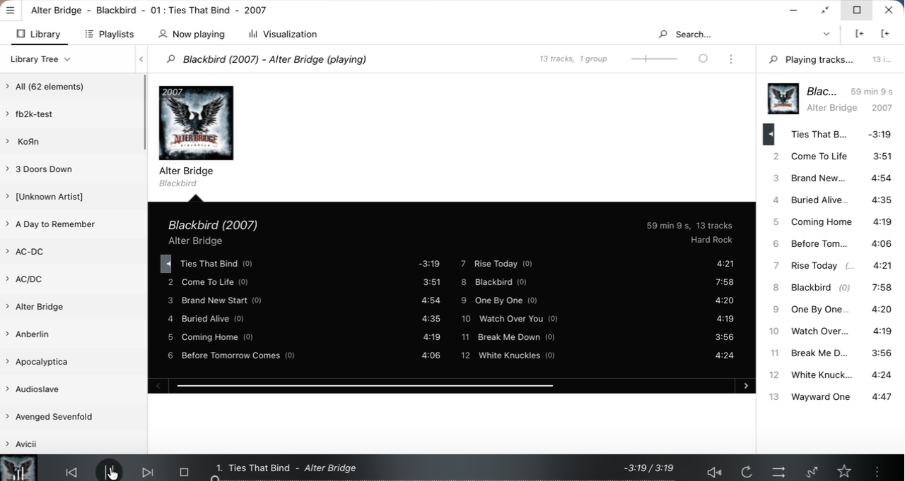
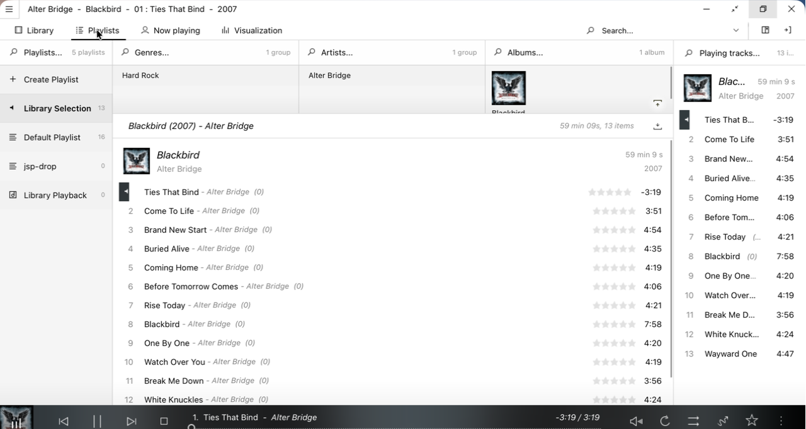
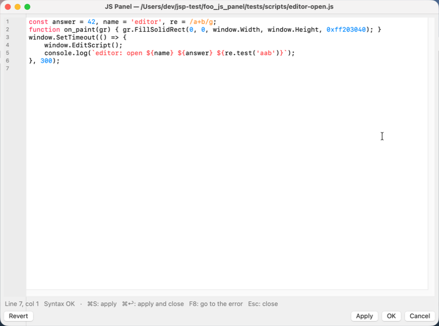
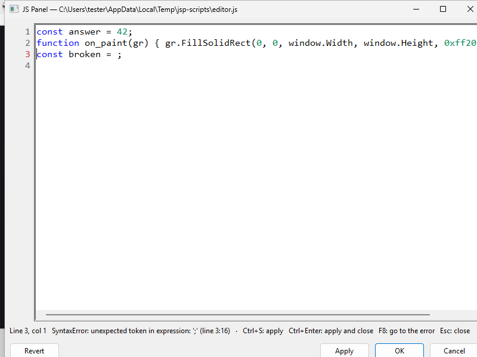
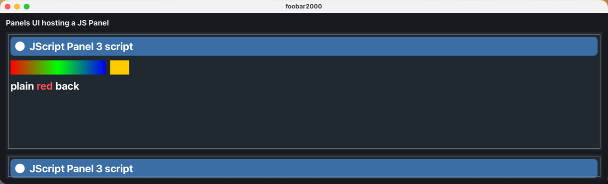
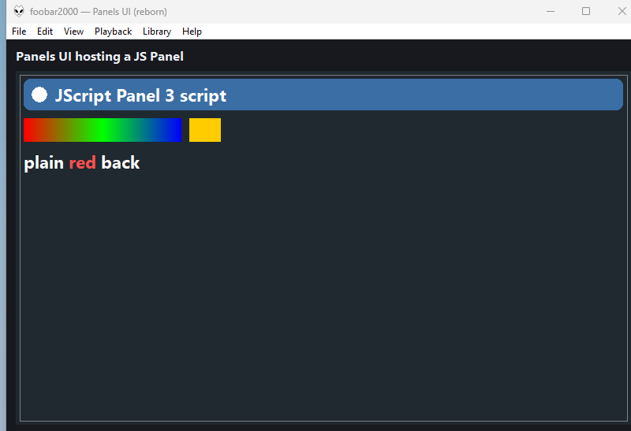
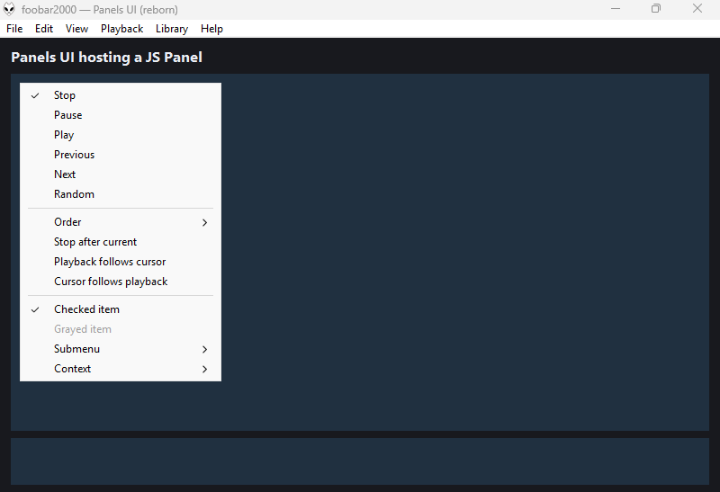

# JS Panel (foo_js_panel)

JavaScript panels for **foobar2000 v2** on **Windows (x64, x86, ARM64) and macOS** (universal).
A panel runs a script that draws itself and reacts to the mouse and to playback, with an API
modelled on **Spider Monkey Panel** (`on_paint(gr)`, `gr.FillSolidRect`, `fb.TitleFormat`,
`window.SetInterval`, …). The goal is for themes built on Spider Monkey Panel / JScript Panel,
which only ever ran on Windows, to run on macOS too.

The engine is [QuickJS-ng](https://github.com/quickjs-ng/quickjs) (ES2023), built into the
component. Nothing else needs installing.

> **Status: early.** The engine, the panel on both platforms and most of the Spider Monkey
> Panel API work, and the Eole theme runs as a Panels UI skin ([how](#running-the-eole-theme)).
> See [Roadmap](#roadmap) for what's left.

## Screenshots

[Eole](https://github.com/Ottodix/Eole-foobar-theme) by Ottodix, imported from its Columns UI layout
and running as a Panels UI skin on macOS, every panel a JS Panel, the library coming from a
Navidrome server through foo_navidrome ([how](#running-the-eole-theme); Eole isn't included here).
Now playing, with the artist's photos, biography and lyrics:



Library and Playlists:

| | |
|---|---|
|  |  |

The script editor, with syntax colours, line numbers and the syntax check in the status line
(on Windows it opened on the line that failed, its number in red):

| macOS | Windows |
|---|---|
|  |  |

A JScript Panel 3 script (gradients, string fonts, `WriteText`) in a Panels UI layout, and a
script's popup menu with foobar2000's Playback menu, checked and grayed items and submenus:

| macOS | Windows |
|---|---|
|  |  |
| |  |

## Installation

Install `foo_js_panel_<version>.fb2k-component` from the
[releases](https://github.com/santiagorod92/foo_js_panel/releases) (*Preferences › Components ›
Install…*). The same file holds the macOS bundle and the three Windows builds.

- **Windows (Default UI):** *View › Layout › Enable layout editing mode*, right-click where it
  goes › *Add New UI Element…* › **JS Panel**.
- **macOS:** *View › Layout › Edit Layout*, add a `foo_js_panel` line; give each panel its own
  script with `foo_js_panel script="~/Music/scripts/now_playing.js"` (`~` is your home folder, a
  relative path starts in the foobar2000 profile folder).
- **Panels UI:** `$panel(MyPanel,JS Panel,x,y,w,h)` in a skin script.

A new panel runs a built-in sample (now playing, a progress bar, click to play/pause).
Right-click it:
- **Edit script…** opens the script in an editor window with line numbers and syntax colours
  (keywords, strings, numbers, comments, regular expressions; pasting always pastes plain text): syntax is checked as
  you type (the status line shows the error and its line, its number turns red, **F8** jumps to
  it), a script that stopped on an error opens on the line that failed, **Apply** (Ctrl+S / ⌘S) saves the file and reloads
  the panel, **OK** (Ctrl+Enter / ⌘↩) applies and closes, **Revert** goes back to what was there
  when it opened. Editing the built-in sample saves it as a new file in
  `<profile>/foo_js_panel/` and the panel switches to it.
- **Choose script file…** picks a `.js` file; **Reload script** re-reads it. A panel also reloads
  by itself within a second when its script, or a file it `include()`s, `@import`s or `import`s, is saved
  from any editor (*View › JS Panel › Reload scripts when their files change*, on by default).
- **Samples** switches the panel to a ready-made script, copied to
  `<profile>/foo_js_panel/samples/` so you can edit it (a copy you already have is kept):
  **Now playing**, **Album art** (the playing or focused track's cover), **Playlist** (the active
  playlist: click, Ctrl/Shift+click, double-click or Enter plays, Delete removes, arrows, the
  wheel, drag tracks out and drop tracks or files in) and **Seekbar and volume**.
 On Windows the choice is saved with that panel; on macOS (where layout elements have no
settings of their own) it's the default script for every JS Panel without a `script=` in the
layout.

## Works with Panels UI

[Panels UI (reborn)](https://github.com/santiagorod92/foo_ui_panels) hosts a JS Panel like any
other panel: `$panel(Browser,JS Panel,0,40,%_width%,$eval(%_height% - 40))`, and
`panel.Browser.script = js/browser.js` in the skin's `foo_ui_panels.ini` picks the script that
panel runs (relative to the skin folder), so every JS Panel in a skin has its own. With JS Panel
installed, Panels UI's layout wizard also offers three layouts built on it, each written out with
its scripts in `js/`, ready to edit:
- **Albums + JS**: the Album browser with a now-playing bar (`js/now_playing.js`:
  the album cover, title, artist and album, progress; click to play/pause, wheel for next/previous).
- **Playlist + JS**: the playlist (double-click or Enter plays, Delete removes, drop files to
  add) with the same bar.
- **Library + Navidrome**: two JS Panels on the left, the Media Library as artists › albums
  (`js/library_tree.js`) and the Navidrome artists (`js/navidrome_artists.js`), next to the
  playlist. Click to select (a panel takes the keyboard when clicked), then double-click or Enter
  plays (the library one through a "Library selection" playlist) and Ctrl+double-click /
  Ctrl+Enter adds; arrows, Page Up/Down, Home/End move, ←/→ fold/unfold an artist.

Both components work without the other. The two share their drawing code (Panels UI's `gfx::Canvas`, GDI+ on Windows and
CoreGraphics/CoreText on macOS), so text and shapes look the same in both.

## Columns UI themes (Eole and others)

Themes made for Columns UI + Spider Monkey Panel ship a layout export, a `.fcl` file. Panels UI
turns one into a skin whose panels are JS Panels: **View › Panels UI › Import Columns UI layout…**
(Panels UI 1.20 or later). Its README's
[Importing a Columns UI layout](https://github.com/santiagorod92/foo_ui_panels#importing-a-columns-ui-layout)
lists what's converted. Third-party themes aren't included here: you download your own copy.

### Running the Eole theme

[Eole](https://github.com/Ottodix/Eole-foobar-theme) runs this way on Windows and macOS, with your
[Navidrome](https://www.navidrome.org/) server as the library if foo_navidrome is installed.

**You need:** foobar2000 v2, JS Panel, [Panels UI](https://github.com/santiagorod92/foo_ui_panels)
as the user interface and Eole itself. Optional:
[foo_navidrome](https://github.com/santiagorod92/foo_navidrome) 1.38 or later for the server's
tracks, ratings and artist photos. Columns UI, Spider Monkey Panel and Eole's other components
aren't needed.

1. **Get Eole:** download it from its GitHub page and unzip it anywhere.
2. **Import it:** *View › Panels UI › Import Columns UI layout…* and pick
   `themes/eole/columnsUI_eole.fcl` in the unzipped folder. Eole's `themes` and `wsh-data` folders
   are copied into your foobar2000 profile folder, the **Eole** skin is written and Panels UI
   switches to it.
3. **Set it up:**
   - **Dark theme:** Eole's ☰ menu (top left) › *Dark theme*, once in each view (Library,
     Playlists, Now playing…). If a panel shown later (such as the Library Tree) is still light,
     toggle it off and on while that panel is visible.
   - **Navidrome library:** on by default (*View › JS Panel › Navidrome tracks in the library*):
     the server's tracks join the Media Library in the filters, the Library Tree and the album
     browser. The first start after foobar2000 opens takes a moment while the list loads.
   - **Title bar:** Eole hides the system title bar and draws its own (drag it to move the window,
     double-click to maximize).
   - **Library filter:** the arrow next to *Genres* switches between Genres, Artists, Albums and
     the Library Tree. In Artists, the photos come from the Biography's cache and, for artists
     it hasn't seen yet, from Navidrome. The Library Tree's arrow menu picks its view (by folder,
     artist, album artist, album, genre, year).
   - **Tracklist background:** the tracks shown under an album take their colour from the cover,
     so a light cover gives a light list. Right-click the album browser › *Tracklist ›
     Background › Transparent background* keeps the theme's own colour.
   - **Biography:** last.fm, Wikipedia and AllMusic text, with photos from last.fm and
     Navidrome. On macOS last.fm's pages may answer foobar2000 with a JavaScript check instead
     (seen in testing; Windows got them), and then the Wikipedia text and the Navidrome photos
     still show.

Eole's view buttons (Library, Playlists, Now playing, Visualization, mini player) and its ☰ ›
*Skin settings › Panel layout* options switch the layout as on Columns UI. Eole's lyrics (ESLyric)
and spectrum (Shpeck) components don't exist on macOS, so the Now playing view's lyrics are Panels
UI's *Lyric Show* and the Visualization view is Panels UI's *Spectrum*.

JS Panel adapts Eole's own files as it loads them, without changing them on disk: `navidrome://`
tracks can be rated like local files, the Biography's and the Artists filter's photos also come
from Navidrome, and Enter in the Library Tree replaces the playlist with the selection and plays
it.

To update Eole, unzip the new version and import it again; your settings stay in
`PROFILE/foo_js_panel/properties/` (`PROFILE` is the foobar2000 profile folder). A skin built by
the Python scripts of JS Panel 1.1 and 1.2 names its panel scripts differently, so its panels start from
Eole's saved settings after the first import.

## JScript Panel 3 scripts

A script written for JScript Panel 3 runs with a compatibility layer over the same engine. It's
picked when the script's `// ==PREPROCESSOR==` header imports `lodash` or a JScript Panel 3 file, or
when it calls JScript Panel 3-only drawing (`gr.WriteText`, `FillRectangle`…):
- The header's `@name`, `@author` and `@version` are `window.Name` and `window.ScriptInfo`'s, for
  Spider Monkey Panel scripts too.
- `@import` lines load before the script: `lodash` is built in (3.10.1, the API JScript Panel 3
  scripts are written for, plus its `nest`), `%fb2k_component_path%`
  is `<profile>/foo_js_panel/jsp3/` and `%fb2k_profile_path%` the profile folder. JScript Panel 3's
  own `helpers.txt` and `samples` folder aren't included: copy them there from its
  `.fb2k-component` (it's a zip) to run scripts that import them.
- `gr`: `Clear`, `FillRectangle`, `DrawRectangle`, `Fill/DrawRoundedRectangle`, `Fill/DrawEllipse`
  (centre and radii), `DrawImage`/`DrawBitmap` (opacity 0–1), `DrawImageWithMask`, `WriteText`,
  `WriteText2`, `WriteTextSimple`, `WriteTextLayout` with JSON font strings and the DirectWrite
  alignment, wrapping and trimming values; see below for `$rgb` and gradients.
- `window.GetFontDUI/CUI` return font strings; `IsDark`, `IsDefaultUI`, `DPI`, `SetSelection`,
  `SetPlaylistTracking`, `SetPlaylistSelectionTracking`.
- `utils`: `CalcTextWidth`, `CalcTextWidth2`, `CreateTextLayout(2)`, `InputBox`, `TextBox`,
  `ColourPicker(default)`, `MessageBox`, `Run`, `ReadUTF8`, `ListFiles`/`ListFolders` (`.toArray()`),
  `IsFolder`, `CreateFolder`, `RemovePath`, `RemoveFolderRecursive`, `RenamePath`, `CopyFile`,
  `GetLastModified`, `Get/SetClipboardText`, `Now`, `TimestampToDateString`,
  `DateStringToTimestamp`, `ReplaceIllegalChars`, `ConvertToAscii`, `HashString`, `LoadImage`,
  `LoadImageAsync`, `HTTPRequestAsync` (`on_http_request_done`), `DownloadFileAsync`, `DownloadImageAsync`.
- `fb`: `ComponentPath` (the folder above), `VersionString`, `CustomVolume`, `CheckComponent`, the
  main-menu shortcuts (`ShowConsole`, `ShowPreferences`, `AddFiles`…); `GetAudioChunk` and
  `GetAlbumArtStub` answer `null`.
- `plman`: `GetPlaylistItemCount`, `FindPlaylist`, `GetPlaylistSelectedIndexes`, `InvertSelection`,
  `RemovePlaylists`, `GetPlaybackOrders`, the lock-mask functions, `SelectQueryItems`,
  `SortPlaylistsByName`, `MovePlaylistSelectionV2`; the playlist recycler is empty.
- Handles and lists: `GetAlbumArtAsync`/`GetAlbumArtThumbAsync`/`GetAlbumArtEmbedded`, `IsInLibrary`,
  `AddItem(s)`, `GetItem`, `InsertItem(s)`, `RemoveByIdx`, `Reverse`, `Randomise`, `SortByPath`…;
  images' `CreateBitmap`, `FlipRotate`.

Every sample of JScript Panel 3.8.5 loads and paints (`make jsp3-check JSP3=<unzipped component>`).
Its buttons use Segoe Fluent Icons, which ships with Windows 11 only: on macOS they show as boxes.
`PushLayer`/`PopLayer` clip; linear gradient brushes fill rectangles (other shapes and radial
brushes use the blend of their first and last stops); `$rgb` codes, `$font` codes and colour-range
arrays colour single-line text (wrapped text draws in one colour). Not there yet: the audio chunk
(VU meters stay still), the playlist recycler.

## What's implemented

| Object | Members |
|---|---|
| callbacks | `on_paint(gr)`, `on_size(w, h)`, `on_key_down(vkey)` (Windows virtual-key codes on both platforms; return `true` when handled, other keys go on to foobar2000's shortcuts), `on_get_album_art_done(handle, art_id, image, path)`, `on_library_items_added / removed / changed(handles)`, `on_mouse_move / lbtn_down / lbtn_up / lbtn_dblclk / rbtn_down / rbtn_up / rbtn_dblclk (x, y, mask)` (return `true` from `on_mouse_rbtn_up` to skip the default menu), `on_mouse_mbtn_down / mbtn_up / mbtn_dblclk (x, y, mask)`, `on_mouse_leave()`, `on_mouse_wheel(step)`, `on_mouse_wheel_h(step)` (horizontal: a tilt wheel, or a sideways trackpad swipe on macOS; positive is right), `on_playback_queue_changed(origin)` (0 added, 1 removed, 2 playback advanced), `on_key_up(vkey)`, `on_char(codepoint)` (WM_CHAR codes on both platforms: Backspace 8, Enter 13, Esc 27), `on_focus(is_focused)`, `on_playback_starting(cmd, paused)`, `on_playback_new_track(handle)`, `on_playback_stop(reason)`, `on_playback_pause(state)`, `on_playback_time(time)`, `on_playback_seek(time)`, `on_playback_edited(handle)`, `on_playback_dynamic_info()`, `on_playback_dynamic_info_track()`, `on_volume_change(db)`, `on_playlist_switch()`, `on_playlists_changed()`, `on_playlist_items_added(p)`, `on_playlist_items_removed(p, new_count)`, `on_playlist_items_reordered(p)`, `on_playlist_items_selection_change()`, `on_item_focus_change(p, from, to)`, `on_playlist_item_ensure_visible(p, i)`, `on_playback_order_changed(order)`, `on_metadb_changed(handles, fromhook)`, `on_notify_data(name, info)`, `on_load_image_done(task_id, image, path)`, `on_selection_changed()`, `on_always_on_top_changed(state)`, `on_playlist_stop_after_current_changed(state)`, `on_cursor_follow_playback_changed(state)`, `on_playback_follow_cursor_changed(state)`, `on_replaygain_mode_changed(mode)`, `on_output_device_changed()`, `on_dsp_preset_changed()`, `on_main_menu(index)` (*View › JS Panel › Script commands › Script command 1–10*), `on_colours_changed()`, `on_font_changed()` (also when macOS switches between light and dark), `on_drag_enter / on_drag_over / on_drag_drop(action, x, y, mask)`, `on_drag_leave()` (`action`: `Effect` (1 copy, 2 move, 4 link; 0 refuses), `Playlist`, `Base`, `ToSelect`, `Text`; when `on_drag_drop` leaves an effect and a playlist, the dropped tracks or files are inserted there at `Base`), `on_script_unload()` |
| `gr` | `FillSolidRect`, `DrawRect`, `DrawLine`, `FillRoundRect(x, y, w, h, arc_w, arc_h, colour)` (arcs are radii), `FillEllipse`, `FillPolygon(colour, mode, points)`, `DrawEllipse`, `DrawRoundRect`, `DrawPolygon(colour, line_width, points)` (points as `[x0, y0, x1, y1, …]` or `[[x, y], …]`), `FillGradRect`, `DrawString` (StringFormat flags), `GdiDrawText` (`DT_*` flags; with `DT_CALCRECT` the box grows to the text, top, centre or bottom aligned, as SMP does), `CalcTextWidth`, `CalcTextHeight`, `MeasureString` → `{ X, Y, Width, Height, Lines, Chars }`, `EstimateLineWrap(text, font, width)` → `[line, width, …]`, `DrawImage(img, dx, dy, dw, dh, sx, sy, sw, sh, angle, alpha)`, `GdiDrawBitmap`, `GdiAlphaBlend`; `SetSmoothingMode`, `SetTextRenderingHint`, `SetInterpolationMode` are accepted. Colours with alpha work for every shape and `DrawString` (`GdiDrawText` ignores alpha, as in SMP). The `gr` from `on_paint` only works inside it; one from `GetGraphics` until `ReleaseGraphics` |
| `gdi` | `Font(name, pxSize, style)` → `Name`, `Size`, `Style`; `Image(path)` (relative to the script's folder), `CreateImage(w, h)` (transparent), `LoadImageAsync(window_id, path)` → task id, then `on_load_image_done`; `LoadImageAsyncV2(window_id, path)` → Promise of the image |
| `GdiBitmap` | `Width`, `Height`, `GetGraphics()` / `ReleaseGraphics(gr)`, `Clone(x, y, w, h)`, `Resize(w, h, mode)` (5 = nearest neighbour), `RotateFlip(mode)` (GDI+ `RotateFlipType`), `ApplyMask(mask)` (white = transparent, same size), `ApplyAlpha(alpha)`, `InvertColours()`, `StackBlur(radius)`, `GetColourScheme(count)`, `GetColourSchemeJSON(count)`, `CreateRawBitmap()`, `SaveAs(path)` (PNG), `Dispose()` |
| `utils` | `IsKeyPressed(vk)` (on macOS ⌘ counts as `VK_CONTROL`), `GetAlbumArtAsync(window.ID, handle, art_id)` (0 front, 1 back, 2 disc, 3 icon, 4 artist; the now-playing track's front cover comes from foobar2000's shared loader, so Navidrome tracks get theirs), `CheckComponent(name, is_dll = true)`, `CheckFont(name)` (whether the face draws as itself; on macOS the Windows UI faces count, see below), `FileTest(path, 'e' / 's' / 'd' / 'split')`, `IsFile`, `IsDirectory`, `FileExists`, `GetFileSize`, `ReadTextFile`, `WriteTextFile`, `ReadINI(path, section, key, default)` / `WriteINI(path, section, key, value)` (on every platform, same rules as Windows: case-insensitive names, quotes dropped, the file's line endings kept), `GetPackageInfo(id)` → `{ Version, Directories: { Root, Assets, Scripts, Storage } }` or `null` and `GetPackagePath(id)` (throws when missing) for Spider Monkey Panel 1.6 packages in `<profile>/foo_js_panel/packages/<id>/` or `<profile>/foo_spider_monkey_panel/packages/<id>/` (a package's `main.js` picked as the panel's script sets `window.ScriptInfo.PackageId`), `Glob(pattern, exc_mask, inc_mask)`, `SplitFilePath`, `FormatDuration`, `FormatFileSize`, `GetSysColour(index)` (Windows `COLOR_*`; the matching system colours on macOS), `ColourPicker(window_id, default)` (the system colour dialog; Cancel, or closing the macOS panel without a change, keeps `default`), `DetectCharset(path)` (65001 UTF-8, 1200/1201 UTF-16, 1252 otherwise, 0 when the file is missing), `MapString(text, lcid, flags)` (`LCMAP_LOWERCASE`, `UPPERCASE`, `HIRAGANA`, `KATAKANA`, `HALFWIDTH`, `FULLWIDTH`; the Chinese conversions return the text unchanged), `InputBox(window_id, prompt, caption, def, error_on_cancel)`, `GetAlbumArtV2(handle, art_id)` (synchronous), `GetAlbumArtAsyncV2(window_id, handle, art_id)` → Promise of `{ image, path }`, `Version` (`"1.6.1"`, the SMP version scripts check), `ShowHtmlDialog(id, code, { data })`: there's no HTML engine, so a dialog that only shows text and buttons becomes a native message box and its callback gets the same answer; one with a form is answered Cancel (and logged) |
| handles | `fb.GetNowPlaying()`, `fb.GetLibraryItems()`, `fb.CreateHandleList()`; `FbMetadbHandle`: `Path`, `RawPath`, `Length`, `FileSize`, `Compare(h)`, `GetFileInfo()` → `MetaCount`, `MetaFind`, `MetaName`, `MetaValue`, `MetaValueCount`, `InfoCount`, `InfoFind`, `InfoName`, `InfoValue`; `FbMetadbHandleList`: `Count`, `Item(i)`, `Add`, `AddRange`, `Insert`, `InsertRange`, `Find`, `BSearch`, `Remove`, `RemoveById`, `RemoveRange`, `RemoveAll`, `MakeIntersection`, `MakeUnion`, `MakeDifference`, `OrderByFormat(tf, dir)`, `OrderByPath`, `OrderByRelativePath`, `Sort`, `GetLibraryRelativePaths`, `CalcTotalDuration`, `CalcTotalSize`, `Clone`, `Convert()` |
| `plman` | `PlaylistCount`, `ActivePlaylist` (get/set), `PlayingPlaylist`, `GetPlaylistName`, `FindOrCreatePlaylist(name, unlocked)`, `ClearPlaylist`, `InsertPlaylistItems(p, base, handles, select)`, `AddLocations(p, paths, select)` (files, folders or URLs, added at the end once foobar2000 has read them), the playback queue: `AddItemToPlaybackQueue(handle)`, `AddPlaylistItemToPlaybackQueue(p, i)`, `GetPlaybackQueueHandles()`, `GetPlaybackQueueContents()` (`{ Handle, PlaylistIndex, PlaylistItemIndex }`, -1 for a track queued outside a playlist), `FindPlaybackQueueItemIndex(handle, p, i)`, `RemoveItemFromPlaybackQueue(index)`, `RemoveItemsFromPlaybackQueue(indices)`, `FlushPlaybackQueue()`, `ExecutePlaylistDefaultAction(p, i)`, `PlaylistItemCount`, `GetPlaylistItems`, `GetPlaylistSelectedItems`, `IsPlaylistItemSelected`, `SetPlaylistSelection(p, indexes, state)`, `SetPlaylistSelectionSingle`, `ClearPlaylistSelection`, `RemovePlaylistSelection(p, crop)`, `MovePlaylistSelection`, `GetPlaylistFocusItemIndex`, `SetPlaylistFocusItem`, `SetPlaylistFocusItemByHandle`, `EnsurePlaylistItemVisible`, `CreatePlaylist`, `DuplicatePlaylist`, `RemovePlaylist`, `RemovePlaylistSwitch`, `RenamePlaylist`, `MovePlaylist`, `IsAutoPlaylist`, `IsPlaylistLocked`, `GetPlaylistLockedActions(p)` / `SetPlaylistLockedActions(p, actions)` (`AddItems`, `RemoveItems`, `ReorderItems`, `ReplaceItems`, `RenamePlaylist`, `RemovePlaylist`, `ExecuteDefaultAction`; `[]` unlocks; a playlist another component locked can't be changed), `GetPlaylistLockName(p)`, `CreateAutoPlaylist`, `ShowAutoPlaylistUI`, `PlaybackOrder` (get/set), `GetPlayingItemLocation()`, `SortByFormat`, `SortByFormatV2(p, pattern, dir)`, `UndoBackup`, `AddItemToPlaybackQueue`, `AddPlaylistItemToPlaybackQueue`, `FlushPlaybackQueue`, `GetPlaybackQueueHandles` |
| `fb` | `TitleFormat(expr).Eval()` (now playing, else the focused track), `.EvalWithMetadb(h)`, `.EvalWithMetadbs(list)` (an array), `IsPlaying`, `IsPaused`, `PlaybackTime` (set it to seek), `PlaybackLength`, `Play`, `Pause`, `PlayOrPause`, `Stop`, `Next`, `Prev`, `Random`, `trace`, `ProfilePath`, `ComponentPath`, `FoobarPath`, `Version`, `Volume` (get/set, dB), `VolumeUp`, `VolumeDown`, `VolumeMute`, `StopAfterCurrent`, `CursorFollowPlayback`, `PlaybackFollowCursor`, `AlwaysOnTop` (get/set; on macOS, where foobar2000 has no such setting, it floats the main window), `ReplaygainMode` (get/set, 0 none, 1 track, 2 album, 3 by playback order), `GetOutputDevices()` / `GetDSPPresets()` (JSON, as in SMP), `SetOutputDevice(output_id, device_id)`, `SetDSPPreset(index)`, `ShowLibrarySearchUI(query)`, `DoDragDrop(window_id, handles, effects, options)` (drags the tracks to any panel or app that takes them; on macOS the drag goes on after the call, which returns 0), `CopyHandleListToClipboard(handles)`, `CheckClipboardContents()`, `GetClipboardContents(window_id)` (tracks copied in foobar2000 or JS Panel, or files), `RunMainMenuCommand('Playback/Stop')`, `RunContextCommand(path)`, `RunContextCommandWithMetadb(path, handles)`, `ShowPopupMessage`, `AcquireUiSelectionHolder()` → `SetSelection(handles)`, `SetPlaylistSelectionTracking()`, `SetPlaylistTracking()`, `Dispose()`; `GetSelection()`, `GetSelections()`, `CreateContextMenuManager()` → `InitContext(handles)`, `InitContextPlaylist()`, `InitNowPlaying()`, `BuildMenu(menu, base_id, max_id)`, `ExecuteByID(id)`; `CreateMainMenuManager()` → `Init('File' / 'Edit' / 'View' / 'Playback' / 'Library' / 'Help')`, `BuildMenu(menu, base_id, count)`, `ExecuteByID(id)`; `GetFocusItem`, `GetQueryItems(handles, query)`, `IsMetadbInMediaLibrary`, `GetLibraryRelativePath` (with `\` separators on macOS too; foo_navidrome tracks get `Album artist\Album\NN - Title`), `CreateProfiler`, `Exit` |
| `window` | `ID`, `Width`, `Height`, `Repaint`, `RepaintRect`, `SetInterval`, `SetTimeout`, `ClearInterval`, `ClearTimeout`, `GetProperty(name, default)` / `SetProperty(name, value)` (kept per script in `<profile>/foo_js_panel/properties/`), `NotifyOthers(name, info)` (every other JS Panel gets `on_notify_data`, `info` copied as JSON), `Reload`, `EditScript`, `ShowConfigure`, `DefineScript` / `DefinePanel`, `ScriptInfo`, `Name` (the name given to `DefinePanel`), `InstanceType` (1, a Default UI element), `IsVisible` (false while the host hides the panel, as Panels UI does with panels outside the current view), `IsTransparent`, `DlgCode`, `MinWidth` / `MinHeight` / `MaxWidth` / `MaxHeight`, `MemoryLimit`, `TotalMemoryUsage`, `JsMemoryStats`, `GetColourDUI` / `GetColourCUI` / `GetFontDUI` / `GetFontCUI` (the host's colours and fonts: Default UI's on Windows, the system's on macOS, following dark mode; the Columns UI kinds map to their Default UI equivalents), `SetCursor(IDC_*)` (arrow, hand, I-beam, cross, sizing and "no" cursors map to their macOS equivalents), `CreatePopupMenu()` → `AppendMenuItem(flags, id, text)` (`MF_GRAYED`, `MF_CHECKED`, `MF_RADIOCHECK`, `MF_SEPARATOR`), `AppendMenuSeparator`, `AppendTo(parent, flags, text)`, `CheckMenuItem`, `CheckMenuRadioItem(first, last, selected)`, `EnableMenuItem`, `TrackPopupMenu(x, y)` → the picked id or 0 (on macOS a Windows `&` accelerator is dropped and `&&` shows as `&`); `CreateThemeManager('TREEVIEW')` draws the tree's expand glyphs; `CreateTooltip()` → `Text`, `Activate()`, `Deactivate()`, `SetMaxWidth(w)` (the system tooltip, shown while the pointer rests on the panel; `TrackPosition` and the delay times are accepted and ignored); `ShowProperties()` (the panel's properties as JSON in the editor window; applying checks the JSON, saves it and reloads the script) |
| global | `include(path)` (relative to the file that calls it), `console.log`, Promises, `setTimeout` / `setInterval` / `clearTimeout` / `clearInterval` (extra arguments are passed on), `new FbMetadbHandleList(handle \| list \| array)`, `new FbTitleFormat(expr)`, `new FbProfiler(name)`, a small `Intl` (`DateTimeFormat`, `NumberFormat`, `Collator` with `numeric`) since QuickJS has none, `fetch(url, { method, headers, body })` → Promise of a `Response` (`ok`, `status`, `url`, `text()`, `json()`; HTTP errors resolve, a network error rejects with a `TypeError`) with `Headers`, through foobar2000's HTTP client; ES modules: a script with a top-level `import` or `export` runs as a module, imports resolve relative to the importing file (and reload it when it changes), and the callbacks it `export`s (`export function on_paint(gr) {…}`) are the panel's callbacks; classic scripts can use `import('./x.js')` |
| `ActiveXObject` | Stand-ins for what Windows themes create, on both platforms: `Scripting.FileSystemObject` (files, folders, text streams, `GetFolder(…).Files` / `.SubFolders` iterable with `for…of` and `.Count`, wildcards in `DeleteFile`), `Microsoft.XMLHTTP` / `Msxml2.XMLHTTP` / `WinHttp.WinHttpRequest.5.1` (GET and POST through foobar2000's HTTP client, async with `onreadystatechange` or synchronous), `WScript.Shell` (`Run` opens URLs and files, and on Windows runs commands; on macOS `shutdown.exe /s`, `/r` and `/h` shut down, restart and sleep the Mac; `cscript` of a download `.vbs` (XMLHTTP + `SaveToFile`, as Biography's `foo_lastfm_img.vbs`) downloads the URL into the file on both platforms; `RegRead` answers the Windows version and DPI keys themes read; `Popup` is a real message box), `htmlfile` (`parentWindow.clipboardData` and a small HTML DOM for scrapers: `createElement`, `innerHTML`, `getElementsByTagName` / `ClassName`, `className`, `innerText`, `href`, `src`, `getAttribute`, `parentNode`), `UIHacks` (`MainWindowState`, `FullScreen`, `MinSize` / `MaxSize` and `SetPseudoCaption` drive the main window: the caption area drags the window and a double-click maximizes; under Panels UI, `FrameStyle` 2 or 3 hides the window's title bar and 0 or 1 shows it; the other settings keep their defaults), `ESLyric` (accepts any call, does nothing), `Shell.Application` and `ScriptControl` (stubs). Any other ProgID throws like JScript did |
| `panelsui` | With [Panels UI](https://github.com/santiagorod92/foo_ui_panels) as the interface: `IsAvailable`, `GetVariable(name, default)`, `SetVariable(name, value)` (the skin's persistent variables, `$getpvar(name)`; the skin repaints), `RunAction(action)` (a skin button action, such as `MINIMODE:TOGGLE` or `PVAR:TOGGLE:name`). The skin talks back: a button with the action `JSPANEL:<name>[:<info>]` reaches every panel as `on_notify_data(name, info)` (`info` parsed as JSON when it is, else the text; no `;` in it, that separates actions), and every change of a skin variable (a `PVAR:` button, a setting, `SetVariable` from any panel) as `on_panelsui_variable_changed(name, value)` |
| `navidrome` | With [foo_navidrome](https://github.com/santiagorod92/foo_navidrome): `IsAvailable`, `IsConfigured`, `GetAlbumsAsync()` → `[{ Id, Name, Artist, ArtistId, CoverArtId, Year, SongCount, Created }]`, `GetArtistsAsync()` → `[{ Id, Name, CoverArtId, AlbumCount, SongCount }]`, `GetArtistInfoAsync(name)` → `{ Id, Biography, ImageUrl, LastFmUrl }`, `SearchAsync(query)` → `{ Artists, Albums, Tracks }` (the server's search: artists and albums shaped as above, `Tracks` an `FbMetadbHandleList` of `navidrome://` tracks ready to play or add to a playlist; needs foo_navidrome 1.40 or later) (all Promises, rejected with the error when the server can't be reached), `PlayAlbum(id, replace = true, play = true)`, `AddAlbum(id)`, `PlayArtist(id, replace, play)`, `AddArtist(id)` |

**Fonts on macOS:** Windows themes name Windows faces. Segoe UI and its Light, Semilight, Semibold,
Bold, Black and Italic variants, Tahoma, Verdana, Calibri and Bahnschrift draw with the system font at
that weight, and Consolas and Cascadia with the system's monospaced font. Icon fonts a theme expects
(FontAwesome, Guifx…) have to be installed, as on Windows.

Colours are ARGB numbers as in Spider Monkey Panel (`0xffRRGGBB`); fills honour alpha. Paths written
with `\` (as Windows themes do, `fb.ProfilePath + 'themes\\eole\\js\\x.js'`) also work on macOS.

A script error stops the script and the panel shows the message and stack. A script that runs
for more than 5 s in one go is stopped (time spent in a popup menu or an input box doesn't count),
and one runtime is capped at 512 MB.

**Diagnostics:** *View › JS Panel › Verbose logging* and *Copy diagnostics*. The log is
`foo_js_panel.log` in the foobar2000 profile folder. *Copy diagnostics* also lists each panel's
memory and its five most expensive callbacks since it loaded (calls, total, average and worst time;
timers count together as `timers`, and time spent in a menu or dialog the script opened doesn't count).

## Roadmap

1. **Phase 0 (this):** engine, panel on both platforms, first API slice, embedded in Panels UI.
2. **Phase 1, the Spider Monkey Panel core** (in progress, ordered by what Eole uses most): done:
   handles and lists, file info, `plman`, panel properties, `NotifyOthers`, `fb` paths, volume,
   menu commands and queries, `utils` files, the playlist and metadb callbacks, popup menus with
   the context and main menu managers, `utils.InputBox`, `window.SetCursor`, `on_key_up` /
   `on_char` / `on_focus` and the middle button, off-screen images (`gdi.CreateImage`,
   `GetGraphics`, `Resize`, `ApplyMask`, `StackBlur`, colour schemes), translucent shapes, async
   image loading, the global timers. Target: the Spider Monkey Panel samples run unchanged.
3. **Phase 2, themes** (in progress): done: the `ActiveXObject` stand-ins above, and
   `make theme-check` to run every Spider Monkey Panel panel of a Columns UI layout export in the
   engine (with Eole's layout, 17 of its 18 panels load and paint offline; the last one needs a
   playing track), and Eole running as a Panels UI skin. Done since: any Columns UI layout
   imported from Panels UI's menu, Eole's patches applied in memory (no Python scripts any more,
   see [Running the Eole theme](#running-the-eole-theme)), font substitution on macOS, a samples
   gallery, per-panel scripts in the macOS layout, JScript Panel 3 scripts.
4. **Panels UI bridge** (done: `panelsui` reads and writes Panels UI variables and runs its
   actions, and skins send messages and variable changes to scripts).
5. **More from foo_navidrome** (done: every track in `fb.GetLibraryItems()` and artist info with
   v3 of its library contract, the server's search with v4).
6. **Later:** JS drawn straight onto the Panels UI canvas (real transparency, zoom, mini mode).

## Reporting a problem

Use the [issue forms](https://github.com/santiagorod92/foo_js_panel/issues/new/choose) and paste
the output of *Copy diagnostics*. It's redacted: your home folder becomes `~` and your user name
`<user>`.

## Building from source

| | Used for development | Notes |
|---|---|---|
| **foobar2000 SDK** | `SDK-2026-10-01` from [reupen/foobar2000-sdk-unmodified](https://github.com/reupen/foobar2000-sdk-unmodified) | shared sibling checkout, like Panels UI and foo_navidrome |
| **foo_ui_panels** | sibling checkout `../foo_ui_panels` | its `src/gfx` + canvas backends are compiled in (`PANELS_UI_SRC`) |
| **JS engine** | QuickJS-ng 0.17.0, vendored in `third_party/quickjs` (MIT) | |
| **lodash** | 3.10.1, vendored in `third_party/lodash` (MIT), built in for JScript Panel 3 scripts | |
| **C++ standard** | C++20 | |
| **Windows** | clang-cl / lld-link (LLVM 22) + xwin, cross-compiled on Linux or macOS | x64 + x86 static CRT, ARM64EC dynamic CRT |
| **macOS** | CMake + Ninja (Xcode tools), universal arm64 + x86_64, macOS 11+ | |

```
make test          # unit tests (engine + API on a recording canvas), ASan/UBSan
make build-all     # Windows x64, ARM64EC, x86 + the macOS bundle
make mac-smoke     # smoke test in this Mac's foobar2000, hosted by Panels UI
make mac-vm-smoke  # the same in the macOS VM on this Mac (terminal-mac; also mac-vm-jsp3, mac-vm-reload)
make mac-demo TEMPLATE=library-js   # this Mac's foobar2000 with a Panels UI JS layout (albums-js, playlist-js, library-js)
make mac-restore   # undo mac-demo / mac-local (skin, settings, the components you had)
make render SCRIPT=x.js OUT=x.png ARGS='--size 600x56 --playing'   # one frame, offline (macOS)
make theme-check LAYOUT=theme.fcl PROFILE=dir   # every SMP panel of a Columns UI layout, offline (macOS)
make jsp3-check JSP3=dir   # every JScript Panel 3 sample of an unzipped foo_jscript_panel3 component, offline (macOS)
make win11-arm-smoke ARCH=arm64ec   # same in the Windows 11 ARM VM (also x64, x86)
make win11-arm-menus ARCH=arm64ec   # a popup menu, an InputBox and keys in the VM, with screenshots
make win11-arm-images ARCH=arm64ec  # off-screen images and translucent shapes in the VM, with a screenshot
make win11-arm-dragdrop ARCH=arm64ec  # a real mouse drag between two panels + the track clipboard in the VM
make mac-dragdrop  # the same in this Mac's foobar2000 (moves the pointer; needs Accessibility)
make mac-reload / make win11-arm-reload ARCH=arm64ec   # a script edited on disk reloads by itself
make win11-arm-editor ARCH=arm64ec   # the editor opens on a broken script's error line, with a screenshot
make mac-jsp3 / make win11-arm-jsp3 ARCH=arm64ec   # a JScript Panel 3 style script, with a screenshot in the VM
```

## Credits

- [QuickJS-ng](https://github.com/quickjs-ng/quickjs) (MIT), the JavaScript engine.
- The API follows [Spider Monkey Panel](https://github.com/TheQwertiest/foo_spider_monkey_panel)
  by TheQwertiest, itself after WSH Panel Mod and JScript Panel. No code is taken from them.
- Thanks to [Ottodix](https://github.com/Ottodix), author of the
  [Eole](https://github.com/Ottodix/Eole-foobar-theme) theme, the target that drove much of this
  work, and to WilB for the Biography script that ships with it. Eole isn't redistributed here;
  [Running the Eole theme](#running-the-eole-theme) only imports and adapts your own copy.

## License

MIT, see [LICENSE](LICENSE).
